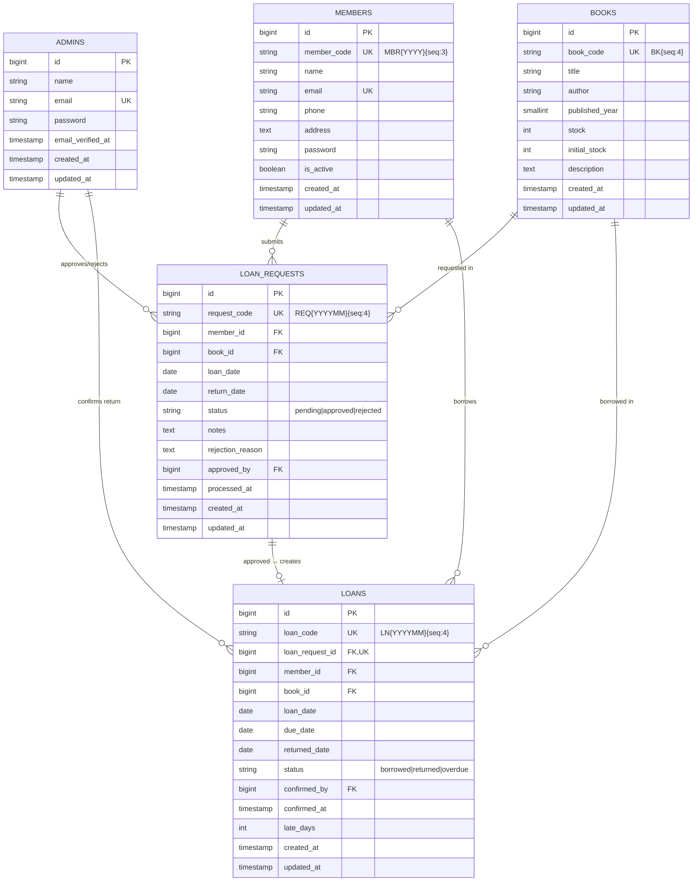
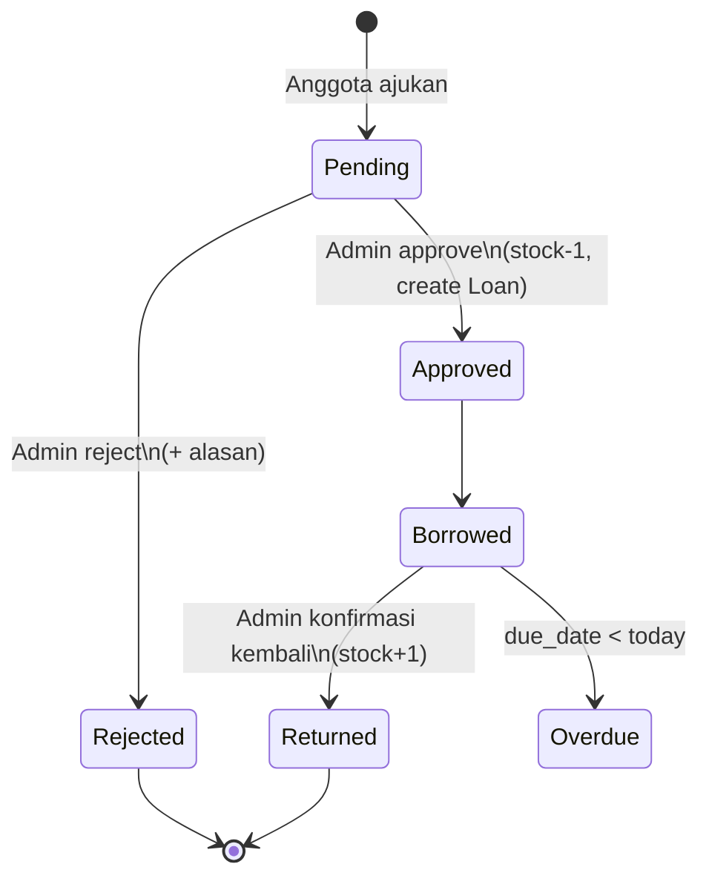

# 📚 Aplikasi Peminjaman Buku

Aplikasi web peminjaman buku berbasis **Laravel 13** dengan multi-guard auth (Admin & Anggota), REST API ber-Sanctum, dan UI modern Tailwind v4 + Yajra DataTables.

Aturan engineering: [`RULES.md`](./RULES.md).

## Stack

- PHP 8.3 · Laravel 13 · SQLite
- Sanctum 4 (API token, guard `sanctum` → provider `admins`)
- Pest 4 + pest-plugin-laravel
- Vite 8 + Tailwind CSS v4 (CSS-first via `@theme`)
- Alpine.js 3 (sidebar, dropdown, modal)
- jQuery 4 + DataTables.net + Yajra DataTables 13 (server-side list)
- SweetAlert2 (konfirmasi destruktif)

## Prasyarat

- PHP 8.3 dengan ekstensi: `pdo_sqlite`, `sqlite3`, `mbstring`, `openssl`, `tokenizer`, `xml`, `ctype`, `json`
- Composer ≥ 2
- **Node ≥ 20.19** (Vite 8 requirement)

```bash
sudo apt install php8.3-sqlite3   # jika ekstensi belum ada
node -v                            # pastikan v20.19+
```

## Instalasi

```bash
composer setup     # install deps + .env + key + migrate + seed + npm install + npm run build
```

Atau manual:

```bash
composer install
cp .env.example .env
php artisan key:generate
touch database/database.sqlite
php artisan migrate --seed
npm install
npm run build
```

## Menjalankan

```bash
composer dev       # multiplex: artisan serve + queue:listen + pail + vite (butuh Node 20+)
# atau:
php artisan serve  # tanpa Vite HMR (asset dibaca dari public/build setelah `npm run build`)
```

Buka <http://127.0.0.1:8000> — root URL otomatis di-redirect ke `/admin/login`.

> Jika setelah `git pull` masih melihat welcome page lama, jalankan:
> ```bash
> php artisan optimize:clear
> ```

### 🔑 Kredensial Demo

Tersedia setelah `php artisan migrate --seed`.

| Role        | Login URL              | Email                  | Password   | Catatan                     |
|-------------|------------------------|------------------------|------------|-----------------------------|
| **Admin**   | `/admin/login`         | `admin@example.com`    | `password` | Akses semua menu admin      |
| **Anggota** | `/member/login`        | `member@example.com`   | `password` | + 9 anggota acak (`MBR2026002`–`010`) yang juga password `password` |
| **API**     | `POST /api/login`      | `admin@example.com`    | `password` | Token Sanctum, return Bearer|

> ⚠️ Ubah password ini sebelum production. Untuk demo biarkan apa adanya.

## Fitur

### Admin (`/admin`)
- Dashboard dengan KPI (Total Buku, Anggota Aktif, Pengajuan Pending, Peminjaman Aktif)
- **CRUD Master Buku** — Yajra DataTables server-side, auto-generate `book_code` (`BK0001`…)
- **CRUD Anggota** — auto-generate `member_code` (`MBR{YYYY}{seq:3}`), password optional saat update, toggle is_active
- **Pengajuan Peminjaman** — list dengan filter status, **approve** (atomic stock decrement, materialize Loan), **reject** dengan alasan via SweetAlert input
- **Peminjaman** — list dengan badge status (Dipinjam/Terlambat/Dikembalikan), **konfirmasi pengembalian** (atomic stock increment, calc late_days)

### Anggota (`/member`)
- Dashboard pribadi dengan 3 KPI
- **Ajukan Peminjaman** — pilih buku tersedia, validasi tanggal di server
- **Pengajuan Saya** — riwayat dengan status badge & alasan tolak
- **Riwayat Peminjaman** — daftar lengkap dengan late_days indicator

### REST API (`/api`) — JSON, Sanctum-protected

| Verb       | Path                       | Deskripsi                              |
|------------|----------------------------|----------------------------------------|
| POST       | `/api/login`               | Issue Bearer token (rate-limit 5/min)  |
| POST       | `/api/logout`              | Revoke current token                   |
| GET        | `/api/books`               | List (paginated, `?search=`, `?per_page=`) |
| GET        | `/api/books/{book_code}`   | Show 1 buku                            |
| POST       | `/api/books`               | Create (auto-generate code jika kosong)|
| PUT/PATCH  | `/api/books/{book_code}`   | Update (`book_code` immutable)         |
| DELETE     | `/api/books/{book_code}`   | Delete                                 |

**Contoh** (`curl`):

```bash
# 1. Login → ambil token
TOKEN=$(curl -s -X POST http://127.0.0.1:8000/api/login \
  -H 'Accept: application/json' \
  -d 'email=admin@example.com&password=password&device_name=cli' \
  | jq -r .token)

# 2. List
curl -H "Authorization: Bearer $TOKEN" -H 'Accept: application/json' \
  http://127.0.0.1:8000/api/books

# 3. Create
curl -X POST -H "Authorization: Bearer $TOKEN" -H 'Accept: application/json' \
  -d 'title=Clean Code&author=Robert C. Martin&published_year=2008&stock=5' \
  http://127.0.0.1:8000/api/books

# 4. Update
curl -X PUT -H "Authorization: Bearer $TOKEN" -H 'Accept: application/json' \
  -d 'title=Clean Code (2nd)&author=Robert C. Martin&published_year=2008&stock=10' \
  http://127.0.0.1:8000/api/books/BK0001

# 5. Delete
curl -X DELETE -H "Authorization: Bearer $TOKEN" \
  http://127.0.0.1:8000/api/books/BK0001
```

## ERD



### State Machine



## Arsitektur

Layering wajib (1 arah, lihat `RULES.md` §1):

```
Routes → FormRequest → Controller → Service → Eloquent Model → SQLite
```

- **Controllers tipis** (validate via FormRequest → call Service → return Resource/Redirect).
- **`LoanService`** mengenkapsulasi state machine (createRequest/approve/reject/confirmReturn) dengan `DB::transaction` + `lockForUpdate` + atomic stock helpers.
- **PHP 8.1 backed enums** untuk status (`LoanRequestStatus`, `LoanStatus`) — tidak ada string magic value.
- **Trait `App\Concerns\GeneratesCode`** untuk auto-code semua model master (`BK`, `MBR{Y}`, `REQ{Ym}`, `LN{Ym}`).
- **Route binding by code** (Book → `book_code`, Member → `member_code`, dst).

## Testing

```bash
php artisan test --compact                      # full suite
php artisan test --compact --filter=approve     # filter
php artisan test tests/Unit/Services            # only unit
```

Coverage:
- **Arch tests** (`tests/Feature/ArchTest.php`): no debug calls, controller suffix, model parents, enum backing, Pest's PHP+Laravel presets
- **Unit/Models**: code generation, casts, scopes, atomic stock ops
- **Unit/Services**: full LoanService state machine including failure paths
- **Feature/Api**: semua endpoint × happy/401/404/422/edge
- **Feature/Admin**: auth + CRUD Buku + CRUD Anggota + approve/reject + confirm-return + guard isolation
- **Feature/Member**: auth + ajukan + scope-to-own-data + cross-guard isolation

Test pakai SQLite `:memory:` (lihat `phpunit.xml`) — instant.

## Kode Style

```bash
vendor/bin/pint --dirty --format agent   # auto-fix gaya kode (wajib sebelum commit)
```

## Struktur Direktori (yang penting)

```
app/
├── Concerns/GeneratesCode.php          # trait auto-code
├── Enums/{Guard,LoanRequestStatus,LoanStatus}.php
├── Exceptions/{Insufficient,InvalidLoan}*.php
├── Http/
│   ├── Controllers/{Admin,Member,Api}/  # namespaced per audience
│   └── Requests/{Admin,Member,Api}/...
├── Models/{Admin,Member,Book,LoanRequest,Loan}.php
└── Services/LoanService.php             # business logic transaksional

database/
├── migrations/   # 5 domain tables + sessions + sanctum + cache + jobs
├── factories/    # full state coverage (approved, returned, overdue, ...)
└── seeders/      # demo data: 1 admin + 10 member + 20 book + 7 request + 5 loan

resources/views/
├── layouts/{app,admin,member}.blade.php
├── components/{card,btn,datatable,form/input}.blade.php
├── admin/{books,members,loan-requests,loans}/...
└── member/{loan-requests,loans}/...
```

## Deployment

Deploy ke Laravel Cloud (atau hosting Laravel lain): lihat panduan lengkap di [`DEPLOYMENT.md`](./DEPLOYMENT.md).

Highlight:
- Production pakai **PostgreSQL**, local SQLite (kode sama, override via env vars).
- Set ~10 env vars di Cloud dashboard (`APP_KEY`, `APP_DEBUG=false`, `DB_*`, dll).
- `composer install --no-dev`, `npm ci && npm run build`, `php artisan migrate --force`.

## Berkontribusi

Lihat [`CONTRIBUTING.md`](./CONTRIBUTING.md) untuk panduan lengkap (workflow, commit format, coding standards, testing, security).

Singkatnya:
1. Fork → branch (`feat/...` / `fix/...`)
2. Implement + test
3. `php artisan test --compact` PASS
4. `vendor/bin/pint --dirty --format agent` clean
5. PR ke `main` dengan deskripsi yang jelas

## Lisensi

[MIT](./LICENSE.md) — bebas digunakan, dimodifikasi, dan didistribusikan dengan menyertakan notice.
